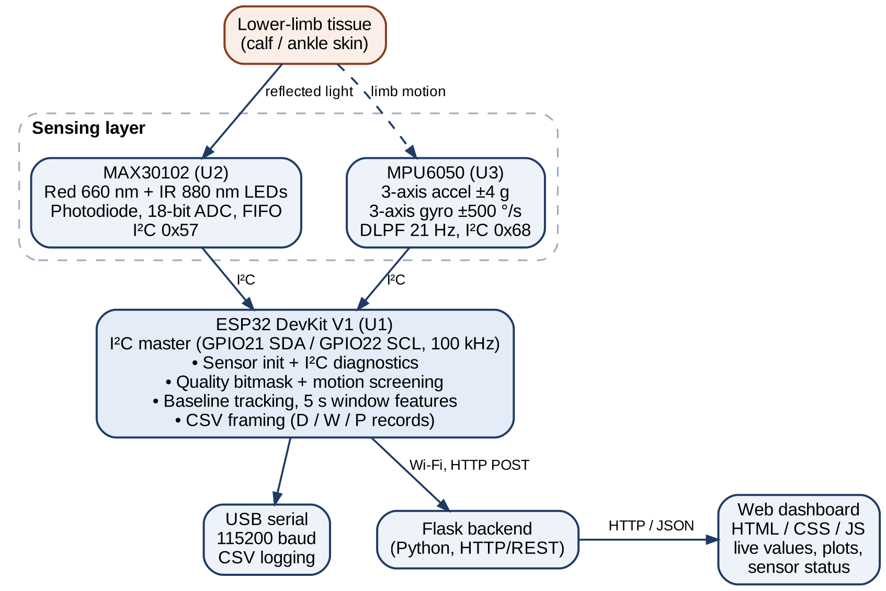
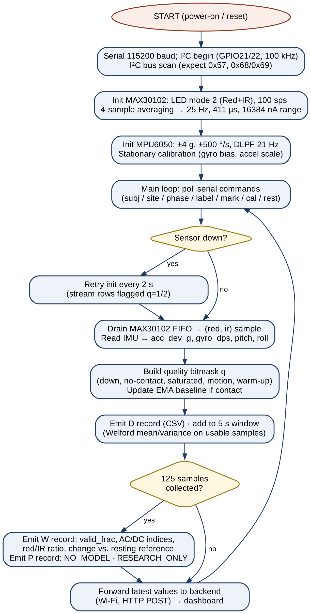
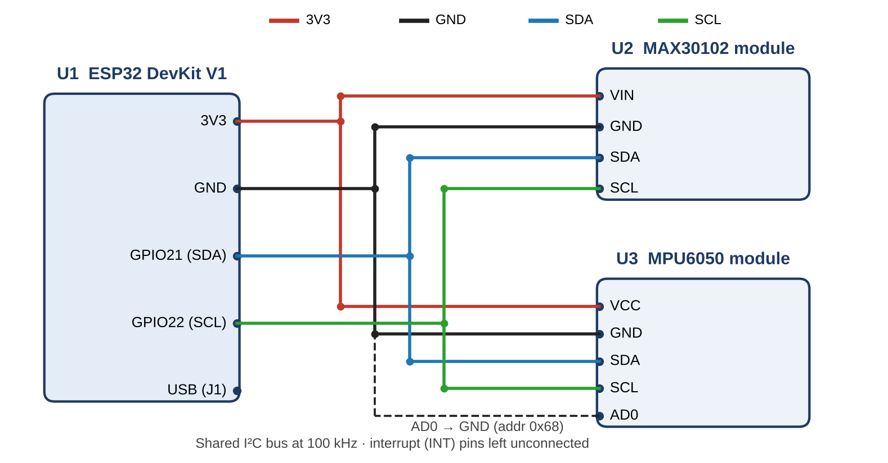

# VENOTRACE | Wearable Optical Sensing & Motion-Aware IoT Dashboard

> A real-time Venous Photoplethysmography (V-PPG) acquisition platform and research monitoring dashboard powered by ESP32, MAX30102, and MPU6050.

[](https://www.espressif.com/)
[](https://fastapi.tiangolo.com/)
[](https://www.python.org/)
[](https://www.arduino.cc/)
[]()

---

## Overview

VENOTRACE is an integrated wearable IoT research platform designed for Venous Photoplethysmography (V-PPG) acquisition and motion-aware hemodynamics screening.

By pairing a dual-wavelength reflective optical sensor (MAX30102) with a 6-axis inertial measurement unit (MPU6050) on a shared I2C bus, the system measures localized venous blood volume fluctuations while actively detecting and screening out movement artifacts in real time.

The repository provides:
1. **Embedded IoT Arduino C++ Firmware:** Standalone Wi-Fi Access Point broadcasting, on-chip HTTP web monitoring, raw TCP telemetry streaming, and deterministic USB serial output.
2. **Local Python Research Dashboard:** Built with FastAPI, SQLite, and an interactive, hardware-accelerated HTML5 Canvas oscilloscope with CSV dataset export capabilities.

---

## Key Capabilities

- **Independent Wi-Fi Hotspot (SoftAP):** The ESP32 broadcasts its own Wi-Fi network (`VENOTRACE_ESP32`). Any laptop or smartphone can connect directly to view live telemetry at `http://192.168.4.1` with zero external routers or campus network dependencies.
- **Dual Connectivity Modes:** Switch seamlessly between wireless TCP streaming (`192.168.4.1:8888`) and high-speed wired USB serial (`115200` baud).
- **25 Hz Real-Time Sampling and Optical Pipeline:** Dual-channel optical acquisition (Red 660 nm and Infrared 880 nm light reflection) with continuous adaptive baseline tracking and percentage deviation calculation.
- **Motion Artifact and Quality Gating (`q` bitmask):** Real-time acceleration deviation ($|\mathbf{a}| - 1\text{g}$) and angular velocity screening to prevent motion artifacts from mimicking venous pooling.
- **5-Second Feature Windows (`W` records):** Computes statistical variation percentages, Red/IR ratio, and relative change from resting baseline using Welford's algorithm.
- **Local SQLite Logging and Research Export:** Full persistence of every raw sample, feature window, model interface record, and diagnostic log with direct CSV downloads.

---

## System Architecture

The following diagram illustrates the complete sensing layer, microcontroller firmware routines, communication protocols, and backend visualization architecture:

<p align="center">
  
</p>

---

## Firmware Acquisition & Processing Flowchart

The firmware executes a continuous loop combining optical FIFO polling, 6-axis motion screening, per-sample quality evaluation, exponential baseline tracking, and 5-second Welford feature calculation:

<p align="center">
  
</p>

---

## Hardware Wiring & Pinout

The MAX30102 optical sensor and MPU6050 IMU communicate with the ESP32 DevKit V1 over a shared I2C bus at 100 kHz:

| Sensor Module | Sensor Pin | ESP32 GPIO Pin | Description |
| :--- | :--- | :--- | :--- |
| **MAX30102** | `VIN` / `VCC` | `3V3` | 3.3V Regulated Power Supply |
| **MAX30102** | `GND` | `GND` | Common System Ground |
| **MAX30102** | `SDA` | `GPIO 21` | I2C Data Line (Address: `0x57`) |
| **MAX30102** | `SCL` | `GPIO 22` | I2C Clock Line |
| **MPU6050** | `VCC` | `3V3` / `5V` | Sensor Power Supply |
| **MPU6050** | `GND` | `GND` | Common System Ground |
| **MPU6050** | `SDA` | `GPIO 21` | I2C Data Line (Address: `0x68` / `0x69`) |
| **MPU6050** | `SCL` | `GPIO 22` | I2C Clock Line |

<p align="center">
  
</p>

---

## Signal-Quality Bitmask (`q`)

Every 25 Hz sample row (`D`) is evaluated against six quality gates combined via bitwise OR:

| Bit Value | Flag Identifier | Trigger Condition |
| :---: | :--- | :--- |
| `1` | `MAX30102_DOWN` | Optical sensor not initialized or missing I2C ACK |
| `2` | `IMU_DOWN` | Motion sensor unavailable or read failure |
| `4` | `NO_CONTACT` | Infrared reflection count $< 20,000$ (poor skin contact) |
| `8` | `SATURATED` | Red or Infrared count $> 260,000$ (near 18-bit ADC ceiling) |
| `16` | `MOTION` | Acceleration deviation $> 0.15\text{ g}$ or angular velocity $> 30^\circ/\text{s}$ |
| `32` | `WARMUP` | Fewer than 250 contact samples (10 s) since baseline reset |
| `0` | `USABLE` | All quality gates passed; eligible for 5-second windowing |

A 5-second window is considered valid only when at least 80% (`MIN_VALID_FRAC = 0.80`) of its samples have `q = 0` and at least 10 valid samples are present.

---

## Embedded Firmware (Arduino IDE)

The repository provides two ready-to-flash sketches inside the [`firmware/`](firmware/) directory:

1. **`VENOTRACE_ESP32_Research_v0_4_WiFi` (Recommended):**
   - Broadcasts the Wi-Fi Access Point **`VENOTRACE_ESP32`**.
   - Serves an on-chip live oscilloscope webpage at `http://192.168.4.1`.
   - Provides high-speed TCP streaming on port `8888` for the Python dashboard.
   - Maintains concurrent USB serial transmission at `115200` baud.
2. **`VENOTRACE_ESP32_Research_v0_4`:**
   - Dedicated wired USB serial streaming firmware at `115200` baud.

### Required Arduino Libraries
Install the following libraries via **Arduino IDE -> Tools -> Manage Libraries...** (`Ctrl + Shift + I`):
- `SparkFun MAX3010x Pulse and Proximity Sensor Library` (by SparkFun Electronics)
- `Adafruit MPU6050` (by Adafruit)
- `Adafruit Unified Sensor` (by Adafruit)
- `Adafruit BusIO` (by Adafruit)

### Flashing Steps
1. Open [`firmware/VENOTRACE_ESP32_Research_v0_4_WiFi/VENOTRACE_ESP32_Research_v0_4_WiFi.ino`](firmware/VENOTRACE_ESP32_Research_v0_4_WiFi/VENOTRACE_ESP32_Research_v0_4_WiFi.ino) in Arduino IDE.
2. Under **Tools -> Board**, select **ESP32 Dev Module** (or **DOIT ESP32 DEVKIT V1**).
3. Connect your ESP32 to your PC via USB and select the corresponding **COM Port** under **Tools -> Port**.
4. Click **Upload** (`Ctrl + U`).

---

## Python Research Dashboard Setup

### Prerequisites
- Python 3.10+ (tested on Python 3.12)
- Windows 10/11, macOS, or Linux

### Quick Start (Windows)
Double-click the included batch launcher:
```bat
start_dashboard.bat
```

### Manual Installation (PowerShell / Terminal)
```powershell
# 1. Create a virtual environment
python -m venv .venv

# 2. Activate the virtual environment
# Windows PowerShell:
.\.venv\Scripts\Activate.ps1
# Windows Command Prompt:
# .venv\Scripts\activate.bat
# Linux / macOS:
# source .venv/bin/activate

# 3. Install dependencies
pip install -r requirements.txt

# 4. Start the dashboard server
python -m uvicorn main:app --host 127.0.0.1 --port 8000
```

Once running, navigate to:
```text
http://127.0.0.1:8000
```

---

## How to Connect & View Data

### Option 1: Direct On-Chip Web Monitor (No Python Required)
1. In your laptop or mobile phone Wi-Fi menu, connect to the network **`VENOTRACE_ESP32`** (Open network, no password required).
2. Open your web browser and go to:
   ```text
   http://192.168.4.1
   ```
3. Real-time PPG waveforms (Red/IR), motion status, and quality flags stream directly from ESP32 memory.

### Option 2: Full Dashboard over Wi-Fi Hotspot
1. Connect your laptop to Wi-Fi **`VENOTRACE_ESP32`**.
2. Start the local server and open `http://127.0.0.1:8000`.
3. In the **Device connection** panel, select the **Wi-Fi Hotspot** tab.
4. Ensure Host is `192.168.4.1` and Port is `8888`, then click **Connect over Wi-Fi**.

### Option 3: Full Dashboard over USB Serial Cable
1. Connect the ESP32 to your laptop using a USB data cable.
2. In the dashboard at `http://127.0.0.1:8000`, select the **USB Serial** tab.
3. Click **Refresh ports**, select the ESP32 COM port, set baud rate to `115200`, and click **Connect ESP32**.

---

## Repository Structure

```text
.
├── docs/
│   └── images/
│       ├── circuit_diagram.png                      # I2C circuit wiring schematic
│       ├── flowchart.png                            # Complete firmware acquisition flowchart
│       ├── overview_block_diagram.png               # High-level system overview
│       ├── measurement_protocol.png                 # Clinical research measurement protocol
│       ├── hardware_prototype.jpg                   # Assembled physical prototype photograph
│       ├── dashboard_preview.jpg                    # Live dashboard interface screenshot
│       └── system_architecture.png                  # Multi-layer system architecture diagram
├── firmware/
│   ├── VENOTRACE_ESP32_Research_v0_4_WiFi/
│   │   └── VENOTRACE_ESP32_Research_v0_4_WiFi.ino   # Wi-Fi SoftAP + Web Server + TCP streamer
│   └── VENOTRACE_ESP32_Research_v0_4/
│       └── VENOTRACE_ESP32_Research_v0_4.ino        # High-speed USB serial firmware
├── static/
│   └── index.html                                   # Real-time HTML5 Canvas UI & control panel
├── data/                                            # SQLite database directory (git-ignored)
├── main.py                                          # FastAPI backend & serial/TCP bridge
├── requirements.txt                                 # Python dependencies
├── start_dashboard.bat                              # One-click Windows launcher
├── .gitignore                                       # Git ignore rules for venv & SQLite
├── .env.example                                     # Optional environment configuration
└── README.md                                        # Project documentation
```

---

## Research Disclaimer

> [!WARNING]
> **This platform is an exploratory research acquisition system, not a certified medical device.**
> Photoplethysmography (PPG) and inertial movement readings cannot independently diagnose, confirm, or rule out Deep Vein Thrombosis (DVT). Model prediction outputs remain disabled (`NO_MODEL`) until trained on approved clinical ground-truth datasets. If DVT is suspected clinically, standard diagnostic medical pathways (such as Duplex Compression Ultrasound) must be utilized.

---

## License

This research prototype is developed for academic, educational, and signal analysis research purposes under course BBMD201L (Biomedical Instrumentation and Measurements - II).
